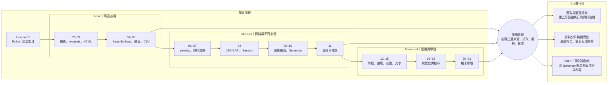

# 爬蟲課學習路徑

本路徑依 CodeGraph 對教材程式的關聯探索，並對照 `COURSE_SYLLABUS.md` 與各堂 README 整理。CodeGraph 可協助追蹤程式如何從請求、解析走到輸出；課程階段與教學目標則以課綱為準。

## 一張圖看課程地圖

## 階段與產出

| 階段 | 課次 | 你在學什麼 | 階段產出／檢查點 |
|---|---:|---|---|
| 語法暖身 | 01 | 複習 Python 基礎與爬蟲常用語法 | 完成 15 題 Learning Exercise |
| 取得網頁 | 02–03 | 網路請求、HTTP 回應、HTML、錯誤與編碼 | 能抓取一頁並判斷請求是否成功 |
| 解析與擴大範圍 | 04–05 | BeautifulSoup 選取元素、翻頁、節流、CSV | 能把多頁內容轉成結構化資料並存檔 |
| 整理資料 | 06–07 | pandas、型態、缺值、重複、欄位拆分與合併 | 能解釋並驗證自己的清理決策 |
| 選對資料入口 | 08 | JSON API、開放資料、Session 與 Cookie 概念 | 能判斷 JSON/API 是否比解析 HTML 更合適 |
| 動態內容 | 09–10 | Selenium、明確等待、捲動、載入更多、找 API | 能處理 JavaScript 才出現的內容，並判斷何時不需要瀏覽器 |
| 檔案素材 | 11 | 圖片與二進位檔案、安全下載與縮圖處理 | 能下載、驗證並整理圖片或檔案 |
| 專題應用 | 12–15 | 財經、PTT、RSS/新聞、文字資料 | 能把前面方法用於不同資料來源 |
| 視覺化與發布 | 16–19 | 圖表選擇、Seaborn/Plotly/NetworkX、HTML 發布 | 能把整理後的資料轉成可分享成果 |
| 專題 | 20–21 | 選題、可爬性與倫理檢查、實作、解讀與發表 | 完成一個可重複執行且可展示的資料專題 |

## 怎麼讀這張地圖

地圖由左向右閱讀：先補 Python 基礎，再逐步經過 Basic、Medium 和 Advanced。各階段裡的課題依序累進；完成爬蟲基礎後，已能開始做小型資料抓取，繼續進階則能處理更多資料來源、分析呈現與完整專題。Selenium 的等待、元素定位和瀏覽器操作也能銜接到 SDET／測試自動化，但這是可延伸的應用方向，不是本課程的完整測試工程訓練。

Python Tutorial 對照表和補課連結在[課程入口](lessons/lesson00_getting_started/README.md#開始前的-python-自我檢查)。

## 目前教材進度

- **已完成：Lesson 01–11**，包含語法暖身、對應 README、learning、exercises、homework 與練習資料。
- **課綱規劃：Lesson 12–21**，請把後半段當作課程藍圖；實際教材會隨製作進度補上。
- **建議自學順序：**依序完成 01–11；若特別想學某個工具，也先確認該堂 README 的先備條件。Lesson 09–10 需要 Chrome，並使用 Notebook 逐格示範。

每堂的具體學習成果和課後練習請看[完整課綱](COURSE_SYLLABUS.md)與[專案首頁](README.md)。
