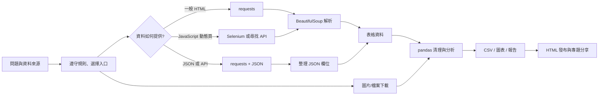

# 專案大綱｜Python 爬蟲程式與資料視覺化

## 專案目的

這是一套循序漸進的爬蟲與資料應用教材。學員從理解網頁如何回應請求開始，學會取得、解析、清理和保存資料，再把資料分析、視覺化並發布。它是 Python 資料分析實戰（course_v2）的延伸課程，但可先用[第 0 章](lessons/lesson00_getting_started/README.md)檢查與補足需要的基礎，不要求先修完所有資料分析內容。

## 端到端資料流程

核心觀念是先選擇合適且允許使用的資料入口。能直接使用官方 API 或開放資料時，通常不必用瀏覽器模擬操作；需要 Selenium 時，也只用於合規的頁面互動，不用來繞過防護。

## 課程模組

| 模組 | 課次 | 模組職責 | 主要方法與成果 |
|---|---:|---|---|
| 起步 | 00 | 自學方法、Python 先備能力、環境與安全規則 | 能執行教材、辨識先備能力缺口 |
| 網頁與 HTTP | 01–02 | 了解瀏覽器、請求/回應、HTML、狀態碼和失敗處理 | requests 取得一頁網頁 |
| HTML 解析與分頁 | 03–04 | 從 HTML 抽欄位、處理相對網址和多頁資料 | 名言/書籍資料列、CSV |
| 資料整理 | 05–06 | 將原始資料轉為可分析表格，處理資料品質 | 清理後的 DataFrame/CSV |
| API 與工作階段 | 07 | 讀取 JSON API、開放資料及本機練習 Session | API 資料表與統計 |
| 動態頁面 | 08–09 | 控制瀏覽器、等待元素、捲動與載入更多 | 擷取動態內容並比較 API 解法 |
| 圖片與檔案 | 10 | 下載、檢查 Content-Type、串流與圖片處理 | 整理過的圖庫與縮圖 |
| 真實題材與文字 | 11–14 | 財經、PTT、新聞/RSS、文字入門 | 不同來源的可重複資料流程 |
| 視覺化與發布 | 15–18 | 選圖、互動圖、關係圖、發布 HTML | 可分享的視覺化頁面 |
| 期末專題 | 19–20 | 選題、檢查合法性、取得資料、分析、發表 | 可展示的完整作品 |

## 專案資料夾怎麼看

- `README.md`：總入口、教材約定、環境安裝和各堂連結。
- `lessons/lessonNN_*/README.md`：該堂成果、先備條件、練習流程與常見問題。
- `lessonNN_learning.py`：逐步示範。多數使用 `# %%` 分格；Lesson 08、09 是需從終端機啟動的腳本。
- `lessonNN_exercises.py`：學員練習與自我檢查。
- `lessonNN_homework.py`：課後延伸練習。
- `fixtures/`：本機快照與示範資料，可供離線練習。
- `COURSE_SYLLABUS.md`：20 堂課的目標、產出和範圍。
- `tools/`：本機練習站、資料快照建置與教材驗證等教師支援工具。

部分解答與教師備課內容不對學生發布。教師專用內容請以正式課程發放版本為準。

## 資料來源與爬取原則

課程優先使用專為練習設計的網站、本機練習站和政府/機構開放資料。爬公開頁面前要確認使用規則，只取分析需要的少量欄位，設定 timeout 並控制請求頻率。沒有明確許可，不大量抓取或轉載內容；遇到 403、驗證碼、登入牆或防護機制，停止並尋找官方 API 或開放資料。

## 預期成果

完成全課後，學員應能說明資料從哪裡來、為何選某種取得方式、如何解析與清理、如何驗證結果，並將分析轉成圖表或可發布頁面。不是只交出能跑一次的程式，而是留下別人能理解、能檢查、能再次執行的流程。

詳細課次順序見[學習路徑](LEARNING_PATH.md)，自學者先從[第 0 章](lessons/lesson00_getting_started/README.md)開始。
